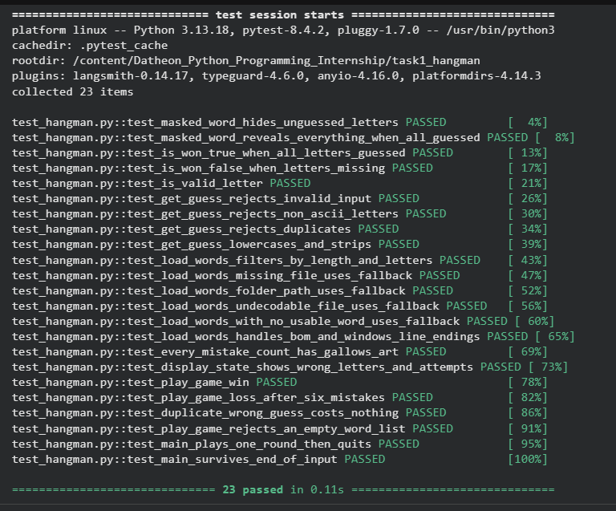
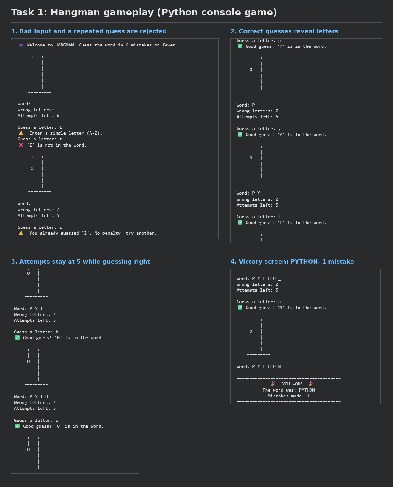
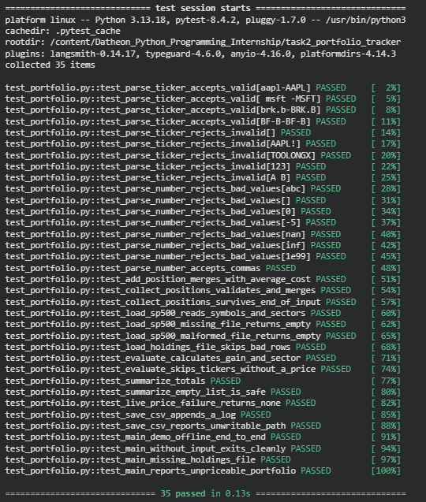
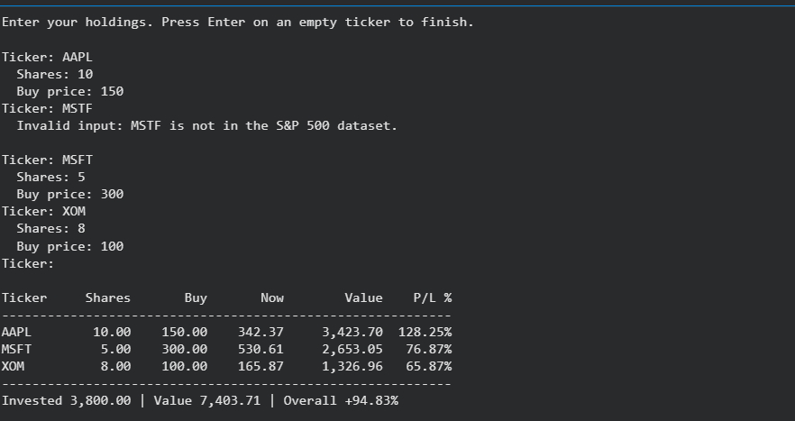
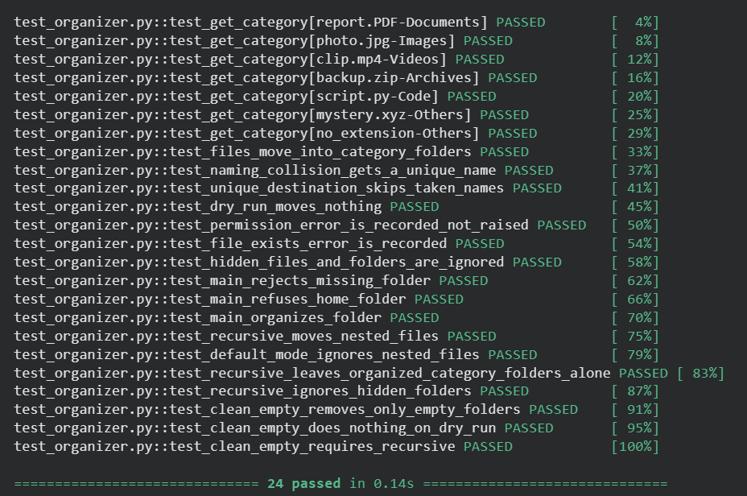
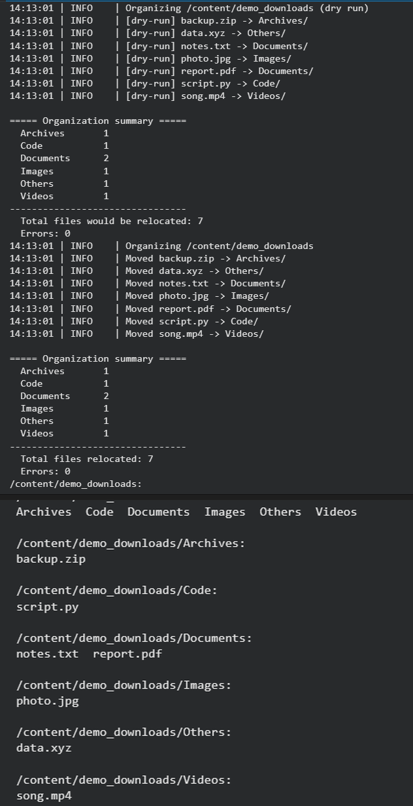

# Datheon Python Programming Internship

Three completed tasks from the Datheon Python Programming Internship,
written in Python 3 with small functions, input validation, error handling
and pytest suites.

| Task | Project | Entry point | Tests |
|------|---------|-------------|-------|
| 1 | Hangman word guessing game (console) | `task1_hangman_game/hangman.py` | 23 |
| 2 | Stock portfolio performance tracker | `task2_portfolio_tracker/portfolio.py` | 35 |
| 3 | Automated file organizer and cleanup utility | `task3_file_organizer/organizer.py` | 24 |

## Repository structure

```
Datheon_Python_Programming_Internship/
├── README.md
├── requirements.txt
├── .gitignore
├── screenshots/
├── task1_hangman_game/
│   ├── hangman.py              main game loop and screens
│   ├── game_logic.py           masking, input validation, win check
│   ├── ascii_art.py            gallows art for each stage
│   ├── word_loader.py          loads and filters words.txt
│   ├── words.txt               English word list
│   └── test_hangman.py
├── task2_portfolio_tracker/
│   ├── portfolio.py            main program
│   ├── portfolio_summary.csv   generated performance log
│   ├── data/sp500_tickers.csv  S&P 500 dataset (ticker check, sectors)
│   └── test_portfolio.py
└── task3_file_organizer/
    ├── organizer.py
    └── test_organizer.py
```

## Setup

Python 3.9 or newer is required.

```bash
pip install -r requirements.txt
```

## Task 1: Hangman

```bash
cd task1_hangman_game
python hangman.py
```

- The secret word is picked with `random.choice()` from `words.txt`
  (5 to 10 letter words). A small built-in list is used if the file is
  missing, unreadable or empty.
- 6 wrong guesses are allowed, and ASCII gallows art updates after each one.
- The word is shown masked (`P Y _ _ _ _`), with the wrong letters and the
  attempts left after every guess.
- Guessed letters are tracked in sets, so a repeated guess is rejected
  without costing an attempt.
- Invalid input (empty, several letters, digits, symbols, accented
  letters) is rejected with a message.
- Victory and defeat screens, and a play-again prompt. Ctrl+C or the end of
  input closes the game cleanly.
- Split into modules: `hangman.py`, `game_logic.py`, `ascii_art.py` and
  `word_loader.py`.

## Task 2: Stock portfolio performance tracker

```bash
cd task2_portfolio_tracker
python portfolio.py --demo               # sample holdings, live prices
python portfolio.py --demo --offline     # sample holdings, fixed sample prices
python portfolio.py --file holdings.csv  # CSV with ticker,shares,buy_price
python portfolio.py                      # type holdings interactively
```

- Holdings are stored in a dictionary of `Position` objects. Repeated
  tickers merge using a weighted-average cost.
- Tickers are checked with a regular expression and against the S&P 500
  dataset. Shares and prices must be positive, finite numbers.
- Prices come from Yahoo Finance (`yfinance`). Tickers that cannot be priced
  are skipped with a message. `--offline` uses fixed sample prices.
- Total invested, market value and % gain or loss are printed per holding.
- Every run is appended to `portfolio_summary.csv` (Python `csv` module),
  with a TOTAL row, so the file works as a performance log.

Sample output (`--demo --offline`):

```
Ticker     Shares       Buy       Now        Value    P/L %
-----------------------------------------------------------
AAPL        10.00    150.00    230.00     2,300.00   53.33%
MSFT         5.00    300.00    420.00     2,100.00   40.00%
XOM          8.00    100.00    110.00       880.00   10.00%
JPM          4.00    180.00    220.00       880.00   22.22%
-----------------------------------------------------------
Invested 4,520.00 | Value 6,160.00 | Overall +36.28%
```

## Task 3: File organizer

```bash
cd task3_file_organizer
python organizer.py ~/Downloads --dry-run   # preview
python organizer.py ~/Downloads             # organize
python organizer.py ~/Downloads --recursive --clean-empty   # whole tree
```

- Files are sorted by extension into `Documents`, `Images`, `Videos`,
  `Archives`, `Code` and `Others` (created on demand).
- Uses `os.scandir()` and `shutil.move()`.
- Name collisions get a numeric suffix (`report (1).pdf`), so nothing is
  overwritten.
- `PermissionError`, `FileExistsError` and other `OSError`s are caught and
  reported in the summary instead of crashing the run.
- `--recursive` also sorts files inside subfolders (already organized
  category folders are skipped) and `--clean-empty` deletes folders that
  are left empty.
- Hidden files and folders are left alone, and root or home folders are
  refused.
- Console and `organizer.log` logging plus a formatted summary.

Sample summary:

```
===== Organization summary =====
  Archives       1
  Code           1
  Documents      2
  Images         1
  Others         1
  Videos         1
--------------------------------
  Total files relocated: 7
  Errors: 0
```

## Running the tests

```bash
cd task1_hangman_game && python -m pytest -v               # 23 tests
cd ../task2_portfolio_tracker && python -m pytest -v  # 35 tests
cd ../task3_file_organizer && python -m pytest -v     # 24 tests
```

Run each command from inside its own task folder.

## Screenshots

### Task 1: Hangman



### Task 2: Stock portfolio tracker



### Task 3: File organizer



## Notes and limitations

- Prices from Yahoo Finance can be delayed. This is a learning project and
  not investment advice.
- The `--offline` prices are fixed demo values, not market data.
- The organizer really moves files. Use `--dry-run` first on a real folder.
